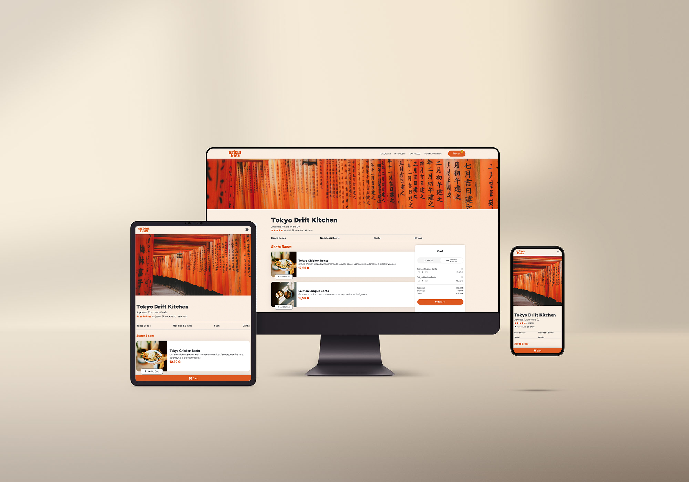

<div align="center">

# URBANEATS

**Browse the menu, fill your cart and watch the price update with every click.**

HTML5 · CSS3 · Vanilla JavaScript

[Live demo](https://stefanstraeter.github.io/urban-eats/) · [Report a bug](https://github.com/stefanstraeter/urban-eats/issues)

<br />



</div>

---

## About

UrbanEats is a mobile-first food ordering app. Browse the menu, add dishes to your cart and switch between delivery and pickup. Totals, fees and the cart badge update instantly, all in the browser and without a framework.

It started as a training project at the Developer Akademie and shows how an e-commerce-like flow can be built with plain JavaScript: data, templates and logic are kept apart, and the cart survives a page reload.

---

## Highlights

- **Data-driven menu** – Every category and dish is rendered from one central data source, no hard-coded markup.
- **Live cart** – Adding, removing and changing quantities (+ / −) updates the list, the totals and the badge immediately.
- **Delivery or pickup** – One toggle switches the mode and recalculates the delivery fee on the spot.
- **Minimum order logic** – The order button respects the minimum order value.
- **Persistent cart** – The cart is saved in `localStorage` and restored on the next visit.
- **Order confirmation** – After ordering, the cart is cleared and a short overlay confirms it.
- **Responsive and accessible** – Mobile-first layout with a slide-in cart, a burger menu and `aria-label`s on icon buttons.

---

## Tech Stack

- **HTML5** with semantic structure
- **CSS3** with Flexbox, Grid and a modular file setup
- **Vanilla JavaScript** with template functions for rendering
- **Local Storage** for the cart

---

## Getting Started

```bash
git clone https://github.com/stefanstraeter/urban-eats && cd urban-eats
```

There is no build step. Open `index.html` with a local server, for example the VS Code Live Server extension.

<details>
<summary><strong>Project structure</strong></summary>

<br />

```text
├── index.html
├── script.js             # Cart logic, events, state, Local Storage
├── scripts/
│   ├── db.js             # Data layer: dishes, categories, prices
│   └── template.js       # HTML template functions
├── styles/               # Modular CSS (cart, components, fonts, footer, reset)
├── style.css             # Base layout
└── assets/               # Images, icons, fonts, gif
```

| File                  | Responsibility                           |
| --------------------- | ---------------------------------------- |
| `scripts/db.js`       | What is on the menu                      |
| `scripts/template.js` | How it looks                             |
| `script.js`           | What happens when the user interacts     |

</details>

<details>
<summary><strong>Technical challenges</strong></summary>

<br />

- **Cart state** – Keeping the cart array, the rendered UI and `localStorage` in sync after every change.
- **Price calculation** – Subtotal, delivery fee and minimum order value must stay consistent when the mode or quantities change.
- **UI synchronization** – Cart list, totals and badge all re-render from the same state, so nothing drifts apart.
- **Responsive UX** – The cart is a side panel on desktop and a slide-in overlay on mobile.

</details>

---

## Author

**Stefan Sträter** · [github.com/stefanstraeter](https://github.com/stefanstraeter/)
